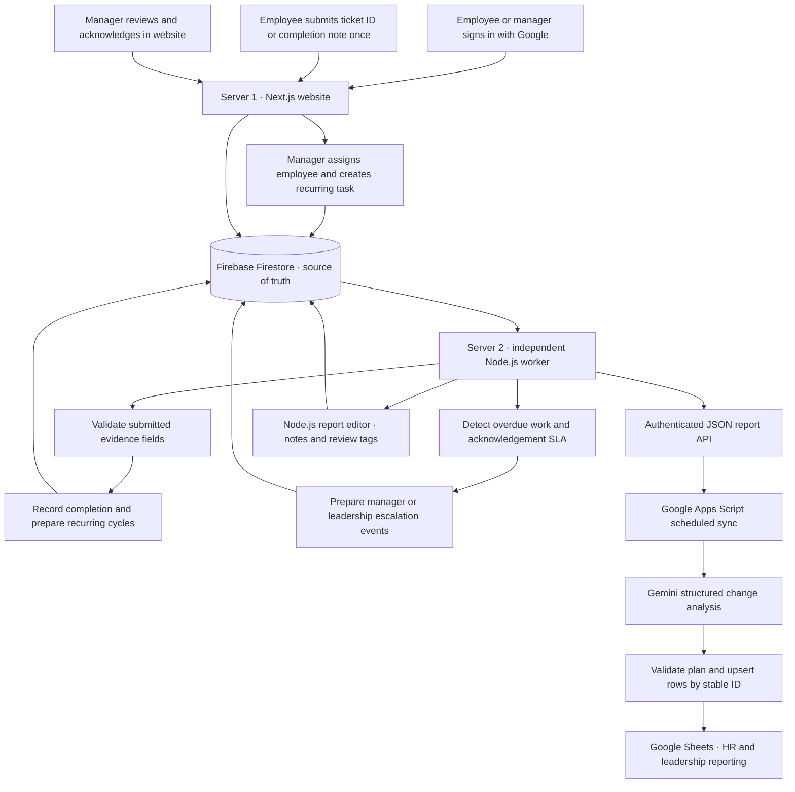
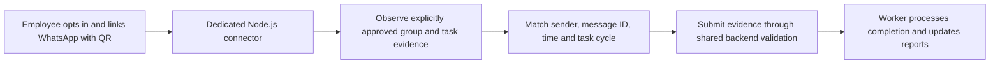

<div align="center">
  <a href="https://alloinnoware.com/">
    
  </a>
  <h1>Allo AI Operations Manager</h1>
  <p><strong>Recurring task assignment · Employee accountability · Automated reporting</strong></p>
  <p>One employee submission connects the website, independent automation server, and Google Sheets.</p>
  <p>
    <a href="https://automate-aw-five.vercel.app"><strong>🌐 Open the live platform</strong></a>
    &nbsp; · &nbsp;
    <a href="#-the-complete-pipeline">🔄 Explore the pipeline</a>
    &nbsp; · &nbsp;
    <a href="#-hr-demonstration-guide">🎬 HR demonstration</a>
  </p>
  <p><code>Next.js + TypeScript</code> &nbsp; <code>Firebase</code> &nbsp; <code>Node.js worker</code> &nbsp; <code>Apps Script + Gemini</code> &nbsp; <code>Google Sheets</code></p>
</div>


## 🔄 The complete pipeline

This node diagram shows who performs each step and where the information moves. GitHub renders it directly in the README.



| Stage | What happens | Result for the business |
| --- | --- | --- |
| **1. Authenticate** | Firebase Google sign-in establishes identity; Server 1 verifies the token and issues an HTTP-only session cookie. New users complete a profile with a unique User ID. | Work is attributed to an authenticated person. |
| **2. Assign** | A manager maps an employee by User ID and creates a task with a deadline, recurrence, priority and evidence requirement. | The employee sees an accountable assignment. |
| **3. Perform and submit** | The employee completes the actual work and enters an external ticket ID, or a daily completion note and optional proof link. | One submission feeds the operational record. |
| **4. Process** | Server 2 checks submitted fields on its independent scan loop, records the completion actor and timestamps, and updates reports. | The current occurrence has traceable completion evidence. |
| **5. Repeat** | Recurrence logic creates deterministic future cycle IDs using the task’s original schedule and configured working-day rules. | Employees do not calculate the next deadline manually. |
| **6. Monitor exceptions** | The worker detects missed deadlines and tracks manager acknowledgement separately from employee completion. | Managers can see unresolved work and review obligations. |
| **7. Escalate** | The worker prepares manager and leadership events according to the configured SLA and records their delivery state. | Escalation history remains auditable; prepared mail is not labelled sent. |
| **8. Synchronize** | Apps Script fetches the paginated Server 2 report; Gemini proposes structured analysis; trusted script code validates and updates matching sheet rows. | HR gets consolidated facts and AI-assisted remarks without duplicate data entry. |

**Why two servers?** Server 1 responds to people using the website. Server 2 runs the automation independently, including when nobody is signed in. Both use the same Firebase project and shared domain rules. Apps Script has its own schedule, so a website update, worker scan and spreadsheet refresh can occur at different times.

## 🖼️ A walkthrough of the running platform

### Employee overview

The overview brings active, completed, overdue and awaiting-review counts into one workspace. In this capture there are three active cycles and one completed cycle.


*The captured “Worker offline” badge reflects the health check at screenshot time. It is not a statement about the worker’s present deployment status.*

### Submit completion from one place

Employees can filter all, active, overdue and completed cycles. Each row carries the task, occurrence, deadline, status and evidence. The completed `BLINF ReTAGG` row records `PORTALXEMPX1` and shows manager acknowledgement; the recurring inventory tasks are still scheduled.


### Manager visibility and acknowledgement

The manager view adds the assigned employee and a task creation action. The same task and ticket reference appear here, allowing the manager to inspect evidence and acknowledge an issue while preserving who actually completed the work.


### Google Sheets output

The `automate_AW` workbook presents Manager → Executive → Task Title with due date, status, required proof and ticket ID. Here, **Executive means Employee**. The `BLINF ReTAGG` / `PORTALXEMPX1` record matches the website screenshots, illustrating the relationship between the operational workspace and the reporting sheet.


*Screenshot values are historical demonstration data. Different display formats or values in separately captured screens should be checked against the source cycle ID and current Firestore record when reviewing a live case.*

## 👥 Roles and the daily operating process

| Role | Main actions | Scope |
| --- | --- | --- |
| Employee | Read assigned tasks; submit evidence; view own reports and activity | Own tasks and history |
| Manager | Assign eligible employees; create tasks; inspect evidence; acknowledge issues; review team reports | Assigned team |
| Leadership | Inspect organization-wide reporting and escalations; configure SLA settings | Approved leadership accounts |

Selecting a role card does not grant leadership access. Leadership emails must be provisioned in the server allowlist. Existing accounts retain their registered role.

### Daily and portal task examples

| Task | Frequency | Employee action | Recorded proof |
| --- | --- | --- | --- |
| Daily Operations Update | Each configured working day | Share the operational update, then record completion in the website | Completion note and optional proof link |
| Portal Task A | Every 7 days | Complete the portal action and submit its external ticket reference | External Ticket ID |
| Portal Task B | Every 15 days | Complete the portal action and submit its external ticket reference | External Ticket ID |
| Portal Task C | Every 30 days | Complete the portal action and submit its external ticket reference | External Ticket ID |

An external ticket ID is distinct from the platform’s task ID. The present verification step validates submitted evidence fields; it does not independently log into the external portal or prove that a WhatsApp message was sent. Recurring cycles preserve past evidence and timestamps instead of overwriting yesterday’s work.

## ⏱️ Overdue work, acknowledgement and escalation

The worker scans every **five minutes by default** (`SCAN_INTERVAL_MS=300000`). Processing occurs on a scan after the relevant deadline or threshold, subject to worker availability.

| Checkpoint | Default behavior |
| --- | --- |
| First scan after a missed deadline | Mark the open cycle overdue and prepare the manager notification event. |
| Manager acknowledgement overdue | Prepare leadership escalation after **24 hours** without acknowledgement, measured from the applicable manager-alert timestamp. |
| Underlying task remains unresolved | Advance checkpoints every **24 hours** and prepare leadership escalation at checkpoint **3**, roughly 48 hours after the first checkpoint under uninterrupted scanning. |
| Employee completes late | Preserve late / post-escalation completion attribution; manager acknowledgement remains a separate action. |
| Repeated scan or retry | Deterministic cycle/event IDs, transactions, scan leases and delivery idempotency reduce duplicate processing. |

Leadership can configure the acknowledgement SLA, checkpoint interval and escalation threshold. Acknowledging a problem does not complete the employee’s task.

> **Email behavior in this version:** `services/automation-worker/src/index.ts` explicitly forces `EMAIL_DELIVERY_ENABLED=false` and `EMAIL_DRY_RUN=true`, including one-shot runs. Firebase notification intents are recorded as `SUPPRESSED`; the runtime sends no new email. While disabled, acknowledgement timing uses notification preparation time for workflow demonstration. Actual delivery timestamps must come from genuine `SENT` events. Enabling real email requires a deliberate runtime change and provider validation; changing environment variables alone does not override the current code.

## 📊 Apps Script, Gemini and Google Sheets

The current AI-assisted reporting pipeline is maintained in the sibling **`AppsScript/`** project distributed with this workspace. It contains `Code.gs`, `Config.gs`, `Transport.gs`, `Gemini.gs`, `Schema.gs`, `Sheets.gs`, `appsscript.json` and its own README/tests. If publishing this web repository alone, distribute that companion project with the handover.

There is also a simpler [legacy integration](integrations/google-apps-script/Code.gs) inside this repository. It reads Server 1’s `/api/sheets` with `SHEETS_SYNC_TOKEN`. **The Server 2 → Gemini pipeline uses `REPORT_API_TOKEN` instead. These are separate integrations and their settings should not be mixed.**

### Workbook guide for HR

| Tab | How HR or a manager uses it |
| --- | --- |
| **Reports** | Review Manager → Executive → task-cycle facts, remarks, tags and follow-up priorities. |
| **Task Master** | Inspect assignments, recurrence, deadlines and evidence requirements. |
| **Employee Pending Report** | Filter `Action Required` to see work requiring employee action. |
| **Manager Monitoring** | Review overdue duration, manager acknowledgement and escalation. |
| **Escalation History** | Inspect prepared, suppressed, failed or actually sent notification events. |
| **Sync Log** | Confirm refresh results, timestamps and errors. |
| **_Sync State** | Hidden synchronization fingerprints; maintained by the script. |


### Install or hand over the Apps Script

1. Open the target Google Sheet → **Extensions → Apps Script**.
2. Copy all companion `.gs` files into one project and use its `appsscript.json` manifest.
3. Run `setDefaultProperties` once, then fill **Project Settings → Script Properties**.
4. Run `diagnoseConnections`, then `setup`; authorize the script and confirm a successful Sync Log entry. The connection check calls Gemini and consumes its quota.
5. After schedule changes, run `installSchedule`. Use `syncOperations` for a manual refresh and `stopAutomaticSync` to remove the current user’s automatic triggers.

| Script Property | Purpose |
| --- | --- |
| `SERVER_BASE_URL` | Final public HTTPS address of Server 2; the script appends `/get-report`. |
| `REPORT_API_TOKEN` | Read-only report token configured on Server 2. |
| `GEMINI_API_KEY` / `GEMINI_MODEL` | Authorized API key and an available model supporting structured output. |
| `SPREADSHEET_ID` | Existing target workbook; may be initialized from the bound sheet or created for a standalone project. |
| `TIMEZONE` | `Asia/Kolkata` by default. |
| `SCHEDULE_KIND` / `SCHEDULE_EVERY` | For a five-minute sync: `MINUTES` / `5`. The companion defaults to `HOURS` / `1`. |
| `AI_CUSTOM_INSTRUCTIONS` | Reporting preferences for summaries, remarks and follow-up. |

Trigger timing is approximate. Worker scanning and sheet synchronization are independent schedules; allow for both before expecting a completion to appear in Sheets. Sheet refreshes are incremental, but a multi-tab run is not one atomic transaction; inspect partial failures in Sync Log.

## 📝 The Node.js report editor

Server 2 includes a browser-based review workspace at:

```text
https://YOUR-WORKER-HOST/report-editor
```

This is a **report editor served by Node.js**, not a visual workflow automation builder. HR can search task reports, add notes, apply custom tags, and mark reviews `UNREVIEWED`, `IN_REVIEW`, `REVIEWED` or `NEEDS_ACTION`.

| Access | Credential | Capability |
| --- | --- | --- |
| Read only | `REPORT_API_TOKEN` | View organization-wide reports |
| Review editing | `REPORT_WRITE_TOKEN` | Read reports and edit allowed annotations |
| Automation controls | `WORKER_API_TOKEN` | Worker controls; does not substitute for a report token |

Enter the token in the editor rather than publishing it in a URL. Tokens stay with authorized reviewers and service integrations.

The editor supports autosave, explicit save, revision checks and audit history. Server-sent events on `/report-events` notify it when data changes. Its annotation edits update the source cycle and derived report transactionally, so a later sheet sync can reflect those changes. Review status is independent of manager acknowledgement. The editor cannot forge completion evidence, alter deadlines or mark an email sent.

For integrations, `GET /get-report?limit=100` returns schema metadata, generation time, pagination and allowlisted collections. Follow `pagination.nextCursor` until `hasMore` is false. Reads are live rather than a cross-collection snapshot.

```sh
# Load REPORT_API_TOKEN securely in your shell before running.
curl --fail --silent --show-error \
  -H "Authorization: Bearer $REPORT_API_TOKEN" \
  'https://YOUR-WORKER-HOST/get-report?limit=100'
```


## 🛠️ Run and maintain the project

### Local development

Requires Node.js 22 or newer. From `workforce-automation/`:

```sh
npm ci --include=dev
cp .env.example .env
# Fill in Firebase, URLs and tokens before starting.
npm run dev
```

In another terminal:

```sh
npm run worker
```

Website: `http://127.0.0.1:3000` · Worker: `http://127.0.0.1:3001` · Editor: `http://127.0.0.1:3001/report-editor`.

`npm run worker:once` performs a single scan and exits. `npm run worker:report` serves reports without scheduled scans. Explicit `DATA_MODE=local` is available for isolated development; production uses Firebase and rejects the local adapter. Local test identities are not production accounts.

### Verification and troubleshooting

```sh
npm run check:config
npm run typecheck
npm test
npm run build
```

For the companion sync, from the parent workspace directory:

```sh
node --test AppsScript/tests/sync.test.mjs
```

Automated tests validate local rules and mocked integrations. Live Google OAuth, Firebase permissions, Gemini access and Sheets execution require their deployed credentials; the project owner reports the deployed pipeline working.

| Symptom | Check |
| --- | --- |
| Google login configuration error | `/api/firebase-config`; four public Firebase runtime variables in the active deployment. |
| `/api/login` returns 403 Permission denied | `APP_BASE_URL` matches the origin used in the browser; deploy the current origin-validation code. |
| Worker offline indicator | Worker `/health`, public `WORKER_URL`, process availability and network response time. |
| Report request returns 401 | Use the read or write report token, not the worker control token. |
| Sheet appears stale | Apps Script Executions, Sync Log, schedule, pagination, Gemini access and quota. |
| Sheet edits disappear | Managed columns mirror the server; use Manual Notes or authorized report annotations. |
| No email arrives | Current worker explicitly disables delivery; inspect suppression state rather than assuming a mail was sent. |

## 💬 Next development cycle: WhatsApp-assisted completion

Some employees perform daily work in WhatsApp groups. A proposed next cycle will evaluate [whatsapp-web.js](https://wwebjs.dev/), a Node.js library that connects through WhatsApp Web, to reduce manual proof entry. **This integration is planned and is not part of the current login or completion flow.** Google remains the website’s authentication method.

The proposed flow is:



The design should map an authenticated employee to an opted-in WhatsApp session, restrict processing to approved groups, and use message IDs to prevent duplicate evidence. Unmatched or ambiguous messages should require review, with the current website submission retained as a fallback.

This requires a separate persistent Node.js/browser process, secure session storage, reconnect handling, session revocation and explicit consent for any message processing. Session credentials must never enter Sheets or the public repository. `whatsapp-web.js` is a third-party WhatsApp Web integration, so account reliability and applicable platform terms need assessment before rollout. It must not be described as an official WhatsApp API or a production feature already delivered. See its [authentication guidance](https://wwebjs.dev/guide/creating-your-bot/authentication.html).

Acceptance criteria for that cycle: employee-controlled linking and unlinking; correct task-cycle matching; no duplicate completion on reconnect; an auditable evidence reference; and no collection of unrelated conversations.

<div align="center">
  <p><strong>Allo Innoware · Operations accountability from assignment to reporting</strong></p>
  <p><a href="https://automate-aw-five.vercel.app">Open the platform</a> · <a href="https://alloinnoware.com/">Company website</a></p>
</div>
